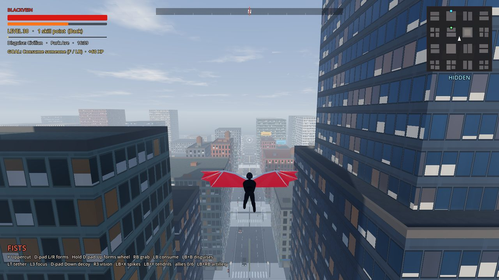
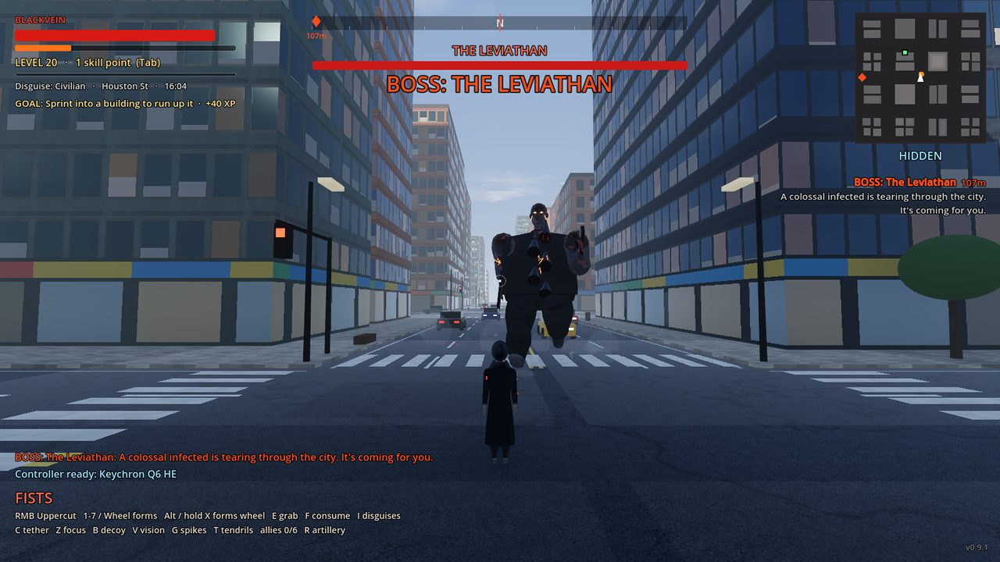
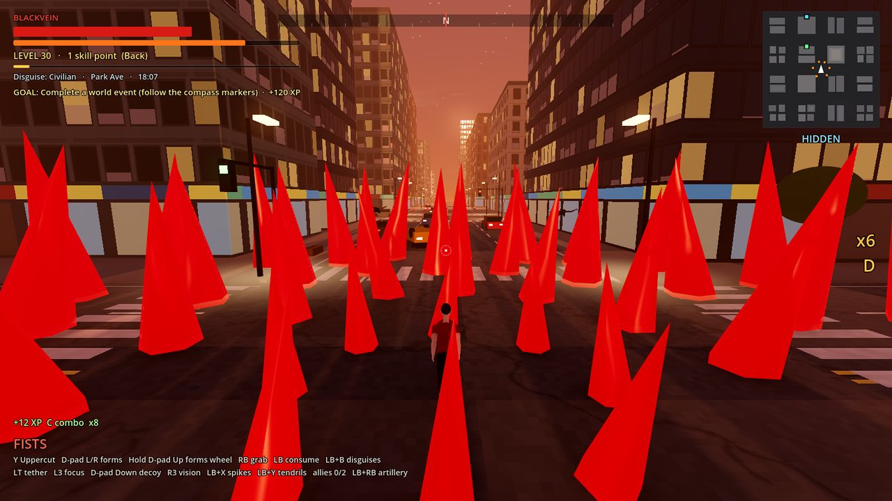
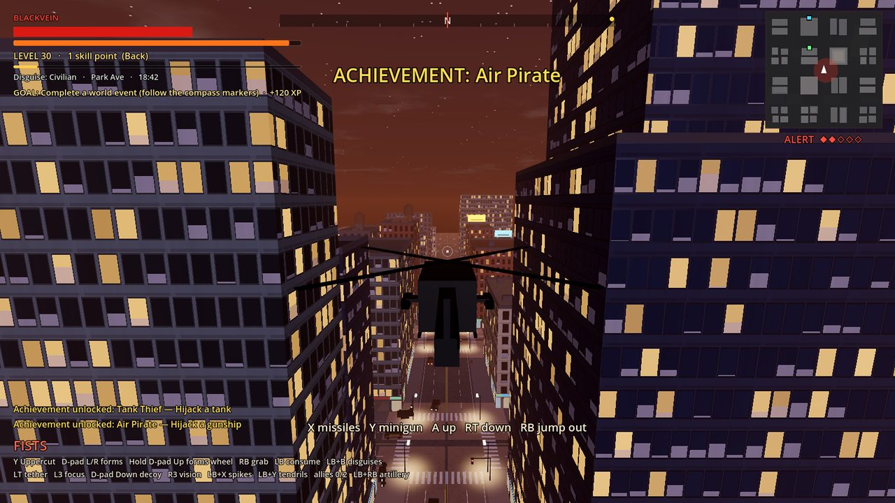
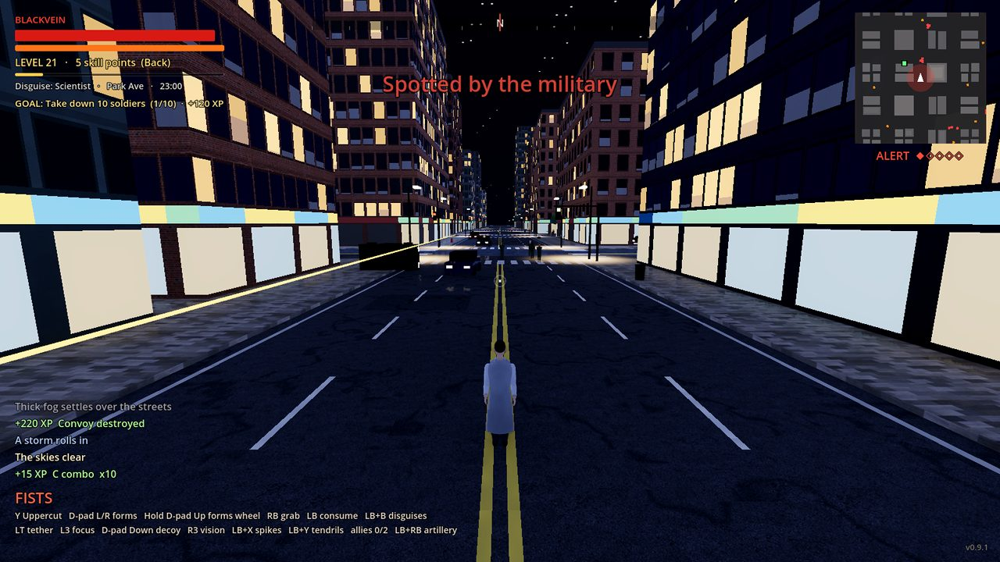
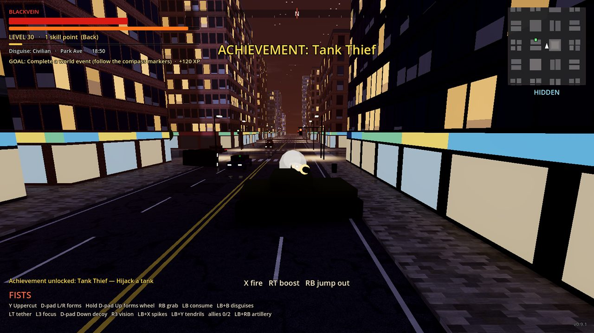
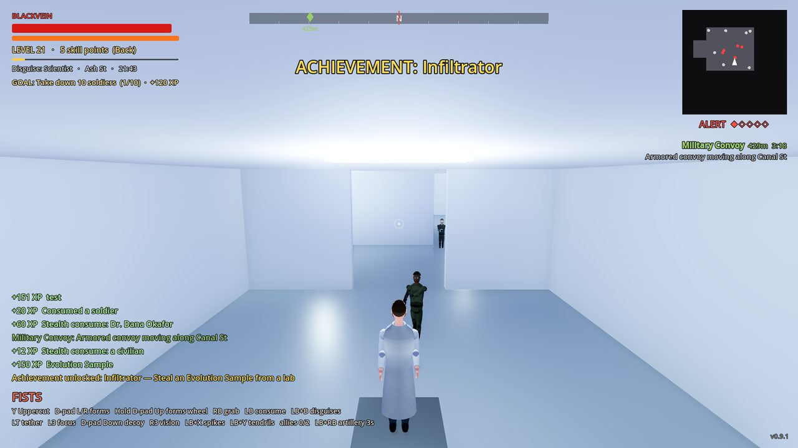
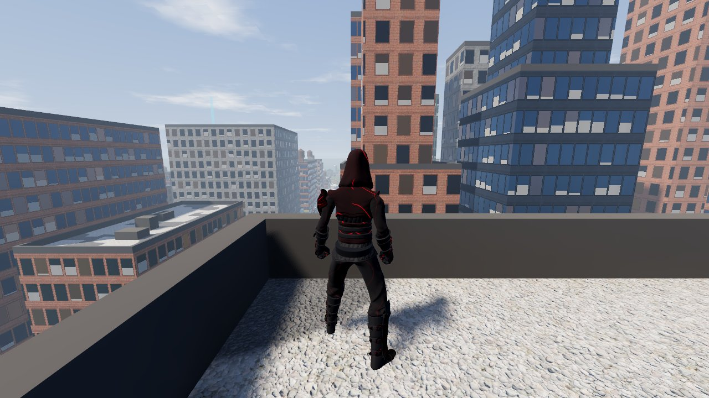
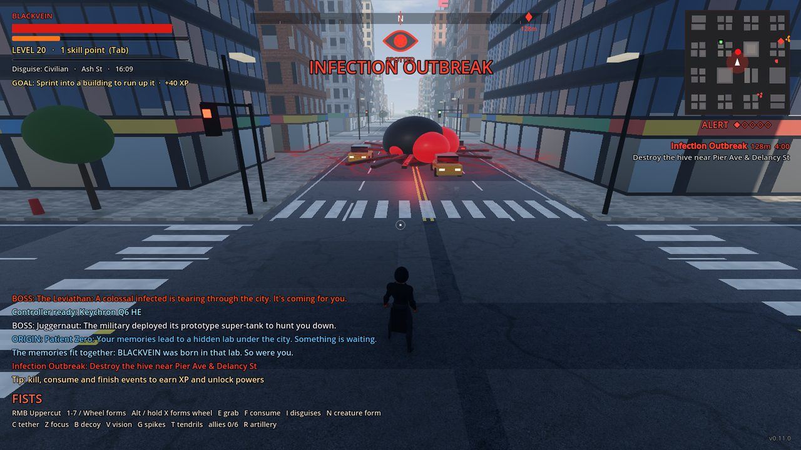

# BLACKVEIN

*The city is infected. So are you.*

[](https://github.com/La2o/BlackVein/releases/latest)
[](https://github.com/La2o/BlackVein/actions/workflows/tests.yml)




An open-world super-power action game made in **Godot 4.5**, inspired by the *Prototype* games.
Run up skyscrapers, glide over the streets, shapeshift your arms into claws, blades and hammers,
consume people to steal their faces, hijack tanks and gunships, and survive a military that
hunts you harder the more chaos you cause.

The city, the vehicles and the sounds are generated by code, dressed with free CC0 photo textures; the
people are rigged, animated CC0 characters by Quaternius (credits in [assets/CREDITS.md](assets/CREDITS.md)).

## Screenshots

| | |
|---|---|
|  |  |
| **The Leviathan** — one of three bosses | **Groundspike** devastator |
|  |  |
| **Hijack gunships** and tanks | **Day and night**, with disguises |
|  |  |
| **Tanks** that fire shells | **Research labs** to infiltrate |
|  |  |
| **Rooftops** over brick and concrete | **Outbreaks** with hives to destroy |

---

## Play it

**Easiest (Windows):** download `BLACKVEIN-windows.zip` from the
[latest release](https://github.com/La2o/BlackVein/releases/latest), unzip it, and double-click
`BLACKVEIN.exe`. If Windows SmartScreen warns you, click **More info → Run anyway** (the game isn't
code-signed). Linux players: grab `BLACKVEIN-linux.zip` instead. Every version, back to the first
playable build, is on the [Releases page](https://github.com/La2o/BlackVein/releases) with its
changes listed.

You need a 64-bit PC with a graphics card that supports Vulkan (most cards from 2016 on).

**From the source (Windows, Mac or Linux):**

1. Download **Godot 4.5** (standard version, not .NET) from <https://godotengine.org/download>.
   It's a single file — no installer, no account.
2. Download this project (on GitHub: green **Code** button → **Download ZIP**) and unzip it.
3. Open Godot, click **Import**, choose the `project.godot` file inside the folder, then **Import & Edit**.
4. Press **F5** (or the ▶ Play button, top right).

The first time it opens, Godot spends a few seconds importing — that's normal.

Your progress saves automatically and loads the next time you play.

### Where your save is

| System | Folder |
|---|---|
| Windows | `%APPDATA%\Godot\app_userdata\BLACKVEIN\` |
| Linux | `~/.local/share/godot/app_userdata/BLACKVEIN/` |
| macOS | `~/Library/Application Support/Godot/app_userdata/BLACKVEIN/` |

`blackvein_save.json` is your game and `settings.cfg` your settings (controls, graphics, volume).
Copy them to back up your progress; delete `blackvein_save.json` (or pick **New game (erase save)** in
the pause menu) to start over.

## Controls

Press **F1** in the game to see them anytime. A controller works out of the box.

| Action | Keyboard & mouse | Controller |
|---|---|---|
| Move / look | WASD / mouse | Left stick / right stick |
| Sprint (run into walls to run up them) | Shift | RT |
| Jump (keeps your speed; hold to leap higher) | Space | A |
| Double jump / glide (hold) in the air | Space | A |
| Dash | Q | B |
| Attack (dive bomb in the air) | Left click | X |
| Form special move · aim a gun (hold on a vehicle to lock rockets on) | Right click | Y |
| Switch arm form | 1–7 / mouse wheel | D-pad left / right |
| Shield / armor | X | D-pad up |
| Grab, throw, hijack, pick up | E | RB |
| Consume | F | LB |
| Tether | C | LT |
| Focus (slow motion) | Z | L3 |
| Head form (vision): Thermal / Night / Predator | V | R3 |
| **Forms wheel** | Hold Alt or X | Hold D-pad up |
| Biomass decoy | B | D-pad down |
| Artillery strike (in military disguise) | R | Hold LB + RB |
| Groundspike devastator | G | Hold LB + X |
| Tendril Barrage devastator | T | Hold LB + Y |
| Skills menu | Tab | Back / View |
| Pause menu | Esc | Start / Menu |
| Map | M | — |

Full list: [docs/CONTROLS.md](docs/CONTROLS.md) · New player? Read [docs/HOW_TO_PLAY.md](docs/HOW_TO_PLAY.md)

## What's in the game

- **Movement:** super sprint, vertical and sideways wall running, charged super jumps,
  double jump, gliding, air dash, tether zips, dive bombs, shockwave landings.
- **Body-part forms, mixed freely on the forms wheel:**
  - **Head:** Thermal Vision, Night Vision, Predator Sense (see enemies through walls).
  - **Arms:** Fists, Claws, Hammerfist, Blade, Whipfist, Musclemass, Bone Spikes — each with its own
    combo and special move.
  - **Body:** Shield, Armor, Wings, Light Body (faster running and jumping, takes more damage).
  - **Legs:** Runner (speed), Leaper (huge jumps), Crawler (cling to walls), Crusher (unstoppable).
- **Prototype-style parkour:** flips, wall backflips, ledge flips, barrel-roll air dashes, landing
  rolls, superhero landings, vaults over cars, a leaning "ninja run" at top speed.
- **Sculpted 3D people:** faces, hands, bending elbows and knees, and outfits for every kind of person.
- **Consume & disguise:** eat anyone to heal and take their identity. Change disguise while unseen
  to make the military lose you. Parkour all you like in a disguise that fits; flying, powers and
  fights give you away. Consume unseen for bonus XP.
- **Grab & throw** people and cars. **Pick up** soldiers' guns: assault rifles, heavy machine guns,
  grenade launchers and rocket launchers that lock onto tanks and gunships.
- **Hijack** tanks and gunships.
- **Devastators:** Groundspike and Tendril Barrage.
- **Original powers:** Tether, Focus (bullet time), Biomass Decoy, Tendril Wings, and
  **Dominate** — brand enemies so they follow you and fight for you.
- **Living city:** civilians, soldiers, rocket teams, grenadiers, heavy gunners, elite strike teams,
  infected, hunters, tanks, trucks and gunships, plus a day/night cycle (the infected come out at
  night).
- **Military alert system:** hidden → suspicious → alert → searching, with escalating heat
  (more soldiers, tanks, gunships, airstrikes).
- **World events:** infection outbreaks with hives, armored convoys, hunter packs, street battles,
  supply drops, strike teams, bombing runs, high-value targets with secret memories, gunship patrols.
- **Bosses:** the Leviathan, the Juggernaut super-tank, and the final boss, Patient Zero.
- **A finale:** piece together 5 memories to find the lab where it all began.
- **Military base** to raid in disguise, with a commander whose memories unlock artillery strikes.
- **Disguise wardrobe:** keep every identity you consume and switch between them — scientists
  get into labs, soldiers into the base.
- **Buildings you can enter:** research labs (with Evolution Samples), the military bunker,
  an infested subway nest with a Hive Heart, and your own safehouse.
- **Traffic and weather:** cars that drive (and crash), rain storms and fog.
- **Combo meter**, starter goals, 19 achievements, a memories log, a stats screen,
  a settings menu with key rebinding, and adaptive music.
- **Progression:** XP from kills, consumes and events → levels → skill points → a skill tree
  of 25 powers and upgrades. Start weak, grind, get monstrous.
- **Save files:** automatic saves every 45 seconds, on level up, and when you quit.

## Project layout

```
project.godot       Godot project settings
scenes/             main.tscn (the game) and player.tscn
scripts/            all game code (one file per system, see docs/ARCHITECTURE.md)
shaders/            buildings, roads, screen effects
sfx/                generated sound effects (rebuild with tools/make_sounds.py)
music/              generated music loops (rebuild with tools/make_music.py)
tests/              automated play-through test (165+ checks)
tools/              helper scripts
docs/               architecture, controls, roadmap
```

## Running the automated tests

```
godot --headless --path . res://tests/test_runner.tscn
```

It plays through movement, combat, every power, vehicles, all world events, leveling and saving,
then prints PASS/FAIL for each check. GitHub runs it automatically on every push
(see `.github/workflows/tests.yml`).

## Making a build yourself

In Godot: **Project → Export**, pick *Windows Desktop* or *Linux*, then **Export Project**
(the first time, Godot offers to download its export templates). Or push a tag like `v0.8.0`
to GitHub and the release workflow builds both, attaching them to a release whose notes come
from CHANGELOG.md. To rebuild an older version, run **Release builds** from the Actions tab and
enter its tag.

## License

MIT — see [LICENSE](LICENSE). Not affiliated with the *Prototype* games or their owners.
